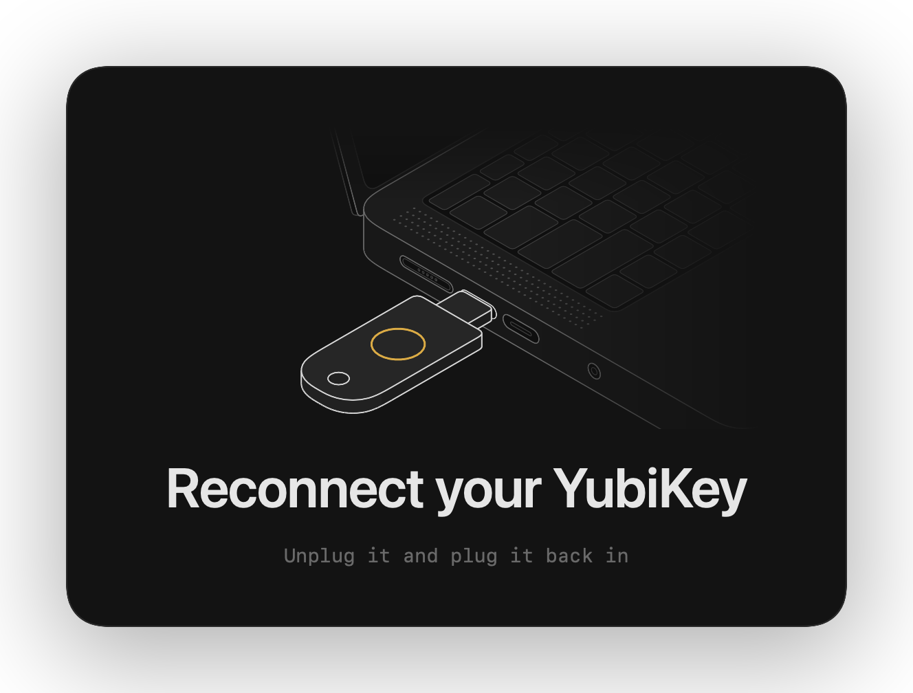

# touch-prompt

A full-screen macOS prompt to touch your YubiKey while git signs a commit, so a missed blink doesn't fail the commit.


Missed touches are retried up to 4 times. If the key isn't found, it asks you to reconnect it.



## Prerequisites

- macOS 14 or later, with the Xcode Command Line Tools for `swiftc`.
- OpenSSH from Homebrew (`brew install openssh`).
- git signing with an SSH security key (`gpg.format ssh`).

## Install

In Claude Code:

```
/plugin install touch-prompt --marketplace martin-saldinger/touch-prompt
/touch-prompt:install
```

The plugin also tells Claude to run signed commits itself and wait for your touch.

Without Claude Code, clone this repo and run `./install.sh`. It builds into `~/.local/bin` and sets `gpg.ssh.program` in your global git config.

## Preview

Run `~/.local/bin/git-ssh-sign --preview` with `touch`, `missed`, or `reconnect` to see a prompt for 6 seconds without signing anything. Add a file path after the mode to save it as an animated PNG in your configured style instead, which needs ffmpeg (`brew install ffmpeg`).

CI renders all three on every pull request and commits them to [docs/screenshots.md](docs/screenshots.md). The images above come from there.

## Settings

Set these with `git config --global`, or without `--global` to apply them to one repo only.

| Key | Default | Values |
|---|---|---|
| `touch-prompt.attempts` | `4` | How many touches to wait for before the commit fails. |
| `touch-prompt.keyName` | `YubiKey` | The key's name in the prompt, as in "Touch your YubiKey". |
| `touch-prompt.sound` | `Glass` | A sound from `/System/Library/Sounds` without `.aiff`, a path to a sound file, or `off`. |
| `touch-prompt.style` | `fullscreen` | `fullscreen` dims every screen behind the card. `card` shows the card without dimming. `hud` shows a small panel in the top-right corner. `menubar` shows a pulsing key in the menu bar. `none` plays only the sound. [Screenshots](docs/screenshots.md#styles). |

For example, `git config --global touch-prompt.sound off` silences the prompt.

## Uninstall

1. Run `git config --global gpg.ssh.program /opt/homebrew/bin/ssh-keygen`.
2. Delete `~/.local/bin/touch-prompt` and `~/.local/bin/git-ssh-sign`.

Drawing palette from the [Anatomy figures](https://skills.wheresryan.sh/anatomy).
