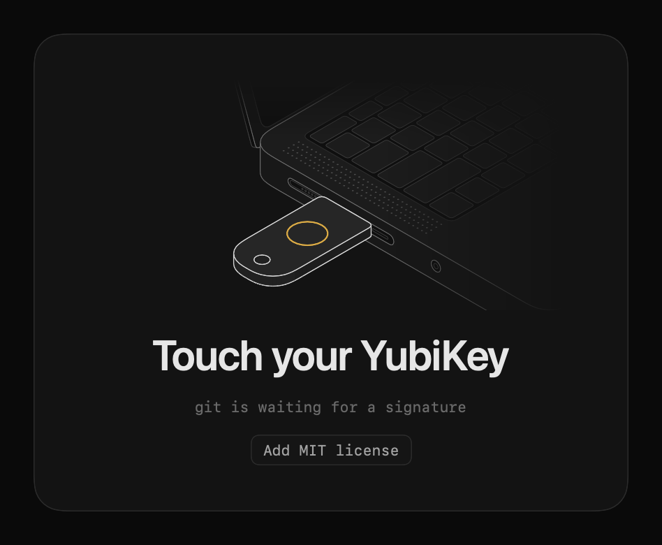
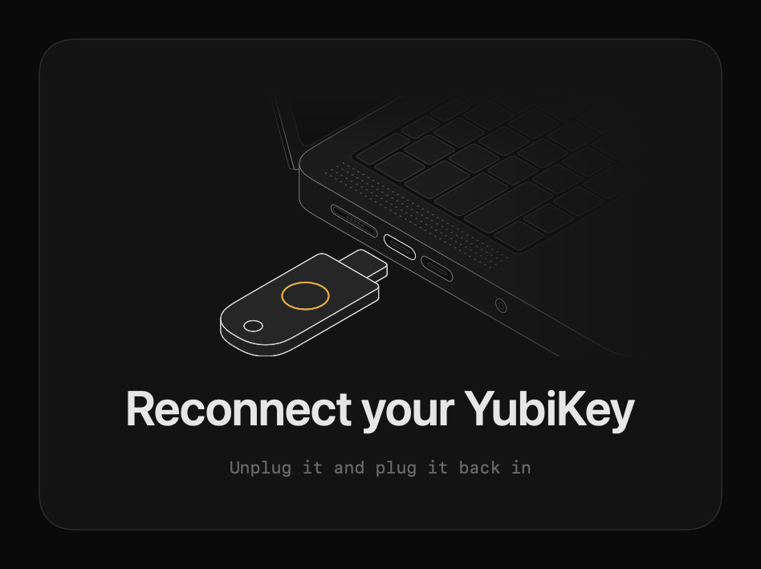

# touch-prompt

A full-screen macOS prompt to touch your YubiKey while git signs a commit, so a missed blink doesn't fail the commit.



Missed touches are retried up to 4 times. If the key isn't found, it asks you to reconnect it.



## Prerequisites

- macOS 14 or later, with the Xcode Command Line Tools for `swiftc`.
- OpenSSH from Homebrew (`brew install openssh`).
- git signing with an SSH security key (`gpg.format ssh`).

## Install

In Claude Code:

```
/plugin install touch-prompt --marketplace martin-saldinger/touch-prompt
/touch-prompt:install
```

The plugin also tells Claude to run signed commits itself and wait for your touch.

Without Claude Code, clone this repo and run `./install.sh`. It builds into `~/.local/bin` and sets `gpg.ssh.program` in your global git config.

To see a prompt without signing anything, run `~/.local/bin/git-ssh-sign --preview` with `touch`, `missed`, or `reconnect`. It defaults to `touch` and closes after 6 seconds. Add a file path after the mode to save a PNG instead. CI does this for every pull request and uploads the images as the `screenshots` artifact.

## Uninstall

1. Run `git config --global gpg.ssh.program /opt/homebrew/bin/ssh-keygen`.
2. Delete `~/.local/bin/touch-prompt` and `~/.local/bin/git-ssh-sign`.

Drawing palette from the [Anatomy figures](https://skills.wheresryan.sh/anatomy).
