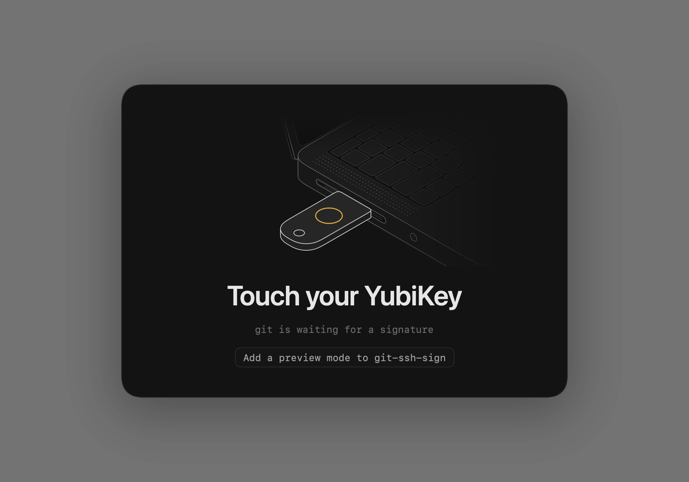
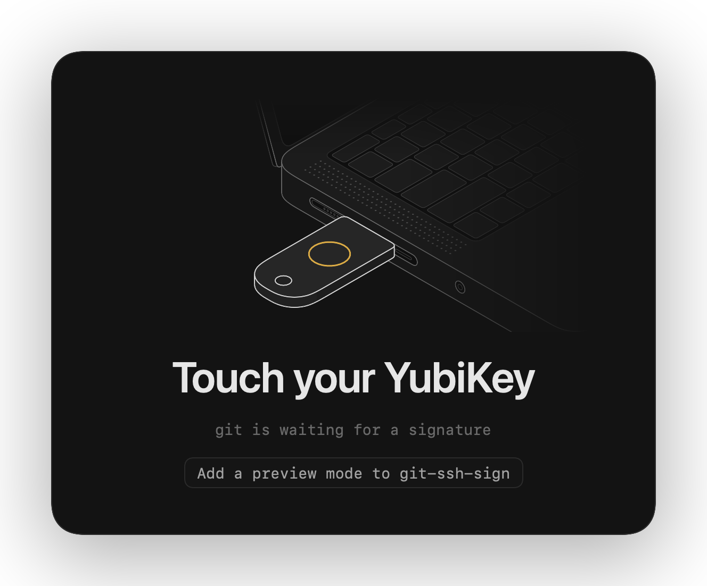
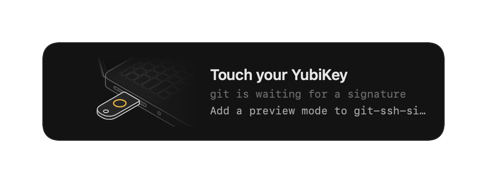
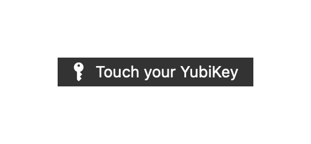

# Screenshots

`.github/workflows/screenshots.yml` regenerates this page with `git-ssh-sign --preview` on every pull request.

## Prompts

### `--preview touch`

### `--preview missed`

### `--preview reconnect`

## Styles

Each shows `--preview touch` with `touch-prompt.style` set. The `menubar` image is drawn for this page; the real one is a system menu bar item.

### `fullscreen`

### `card`

### `hud`

### `menubar`

### `none`

Plays only the sound.
